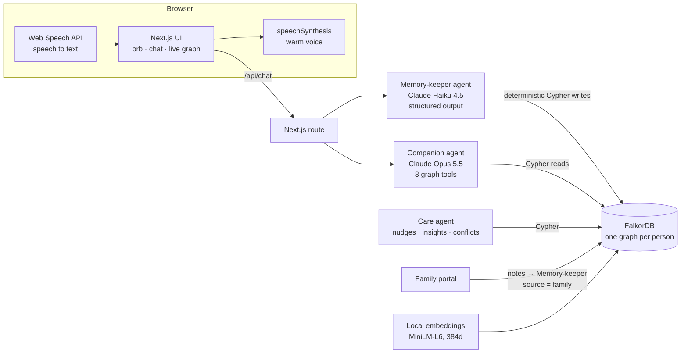

# Mithi

**A sweet voice companion that remembers your world.** Mithi ("sweet" in Marathi and Hindi) is a voice-first personal agent whose long-term memory is a FalkorDB graph. It remembers the people in your life and how they connect to you, what happened and when, your routines and medicines, and how you have been feeling. Every answer lights up the exact graph path it was recalled from.

It has an **elder mode** built for people with early memory loss. Family and caregivers seed and correct the memory, and the companion never argues when Aaji (grandma) remembers something differently. It flags the conflict for the family instead.

> **Hackathon:** Graph Hacks: Context for AI Agents (FalkorDB × WeMakeDevs), Oct 15–18 2026
> **Track:** Track 02 · Agent Memory and Coordination (also relevant to Track 01 · Agents That Act on Connected Data)
> **Demo video:** [docs/mithi-demo.mp4](docs/mithi-demo.mp4) · **Live demo:** _add link, or run locally below_

---

## What it does

| Ask (by voice) | What happens in the graph |
|---|---|
| "Who is Raju again?" | Full-text match on name and nicknames, then the shortest family path `Aaji ← CHILD_OF – Priya ← CHILD_OF – Raju`, where he lives now, his upcoming visit, and the last time he came up |
| "Raju told me he moved to Bangalore" | The Memory-keeper sees that a family-sourced fact is being contradicted by an unverified claim. It adds an unverified `LIVES_IN` edge plus a `Conflict` node for the family. Nothing is deleted. Once family confirms, the old edge gets `valid_to` and stays in history |
| "Did I take my tablet today?" | Procedural memory: `(me)-[:FOLLOWS]->(Routine)-[:INCLUDES]->(Med)`, checked against today's `TOOK {day}` edges |
| "Let me tell you about the mango tree…" | A vector search over `Story` embeddings recognises a retelling told in different words. A third telling in 7 days becomes a gentle note for family |
| "I'm feeling anxious about tomorrow" | Mood per session × weekday, plus the entities mentioned in low-mood sessions → "Sunday nights, before the Monday standup" |
| "Who haven't I talked to in a while?" | PageRank over the people graph, joined with the last time each person was mentioned |

## Why a graph

A companion's memory is mostly relationships: *who is whose grandson*, *which story is about which place*, *which sessions mentioned which worry*, *which fact replaced which*. Mithi uses FalkorDB for all of it:

- **Multi-hop recall.** Family paths, `find_connection` between any two memories, and expansion from a vector hit to the people and places it mentions.
- **Facts that change over time.** `LIVES_IN` edges carry `valid_from` / `valid_to`, and every fact and edge keeps `source` and `confidence`. Family outranks unverified claims.
- **Three agents, one shared graph.** The Companion reads, the Memory-keeper writes, and the Care agent watches. Family members write through the portal. Conversation history itself lives in the graph (`Session → Utterance`), so it survives restarts and every agent sees the same history.
- **Built-in indexes and algorithms.** Vector indexes (stories, facts, utterances), a full-text index (names and nicknames), and PageRank (who matters most).
- **One graph per person** (`mithi:kamala`, `mithi:arjun`), using FalkorDB's multi-graph tenancy.

## Architecture



- The **Memory-keeper** never writes Cypher itself. It returns a typed extraction (people, relations, moves, events, stories, facts, doses, mood), and `src/lib/memory.ts` applies it with fixed, parameterised queries. Relationship types come from an allow-list.
- The **Companion** has eight tools (`src/lib/tools.ts`). Each returns data plus a **trace**: the Cypher that ran and the node and edge ids it touched. The UI uses the trace to light up the path and to show the queries under each answer.
- The **Care agent** (`src/lib/care.ts`) is plain Cypher: missed doses, upcoming events, drifting relationships, repeated stories, open conflicts, unverified people.

## Data model

```
Semantic    (:Person {id, name, nicknames, note, self, verified, source})
            (:Person)-[:CHILD_OF|SPOUSE_OF|SIBLING_OF|FRIEND_OF|CAREGIVER_OF|NEIGHBOUR_OF|COLLEAGUE_OF {source}]->(:Person)
            (:Person)-[:LIVES_IN {valid_from, valid_to, source, confidence, verified}]->(:Place)
            (:Fact {text, source, confidence, valid_from, embedding})-[:ABOUT]->(any)
            (:Person)-[:RECOMMENDED]->(:Thing)      (:Topic)      (:Preference)<-[:PREFERS]-(:Person)

Episodic    (:Person {self})-[:HAD]->(:Session {at, day, weekday, hour, mood})-[:CONTAINS]->(:Utterance {speaker, text, at, embedding})
            (:Utterance)-[:MENTIONS]->(Person | Place | Event | Story | Thing | Topic)
            (:Person)-[:HAS_EVENT]->(:Event {title, date, kind})-[:AT]->(:Place)
            (:Person {self})-[:TOLD {at}]->(:Story {title, summary, embedding})-[:ABOUT]->(Person | Place)

Procedural  (:Person {self})-[:FOLLOWS]->(:Routine {name, time})-[:INCLUDES]->(:Med {name, dose})
            (:Person {self})-[:TOOK {day, at}]->(:Med)

Coordination (:Person)-[:WROTE]->(:Note {text, role, at})        family and caregiver input
             (:Conflict {kind, text, status})-[:ABOUT]->(:Person)  waiting for family to confirm
```

Indexes (`ensureSchema` in `src/lib/memory.ts`): range indexes on `id`, a full-text index on `Person(name, aliases)`, and 384-dimension cosine vector indexes on `Utterance.embedding`, `Fact.embedding` and `Story.embedding`.

## Cypher the product depends on

**Family path to a person** (`recall_person`, `upcoming_events`)
```cypher
MATCH (me:Person {id: $self}), (t {id: $target})
MATCH p = (me)-[:CHILD_OF|SPOUSE_OF|SIBLING_OF|FRIEND_OF|CAREGIVER_OF|NEIGHBOUR_OF|COLLEAGUE_OF*1..4]-(t)
WITH p ORDER BY length(p) LIMIT 1
RETURN [n IN nodes(p) | n.id] AS ids, [n IN nodes(p) | n.name] AS names,
       [r IN relationships(p) | [startNode(r).id, endNode(r).id, type(r)]] AS rels
```

**Name and nickname lookup** (full-text index)
```cypher
CALL db.idx.fulltext.queryNodes('Person', $term) YIELD node, score
RETURN node.id AS id ORDER BY score DESC LIMIT 1
```

**Semantic recall, expanded through the graph** (`search_memories`)
```cypher
CALL db.idx.vector.queryNodes('Utterance', 'embedding', 6, vecf32($vec)) YIELD node, score
OPTIONAL MATCH (node)-[:MENTIONS]->(x)
RETURN node.text, node.at, score, collect({id: x.id, name: coalesce(x.name, x.title)}) AS about
ORDER BY score
```

**Facts that change: close, never delete** (`setLivesIn`)
```cypher
MATCH (p:Person {id: $p})-[r:LIVES_IN]->(:Place) WHERE r.valid_to IS NULL
SET r.valid_to = $now;
MATCH (p:Person {id: $p}), (pl:Place {id: $pl})
CREATE (p)-[:LIVES_IN {valid_from: $now, source: $source, confidence: $conf, verified: true}]->(pl)
```
If an unverified claim contradicts a family fact, Mithi creates `LIVES_IN {verified:false}` plus a `(:Conflict)-[:ABOUT]->(person)` and leaves the family fact in place.

**Retold story detection** (`tellStory`)
```cypher
CALL db.idx.vector.queryNodes('Story', 'embedding', 1, vecf32($vec)) YIELD node, score
RETURN node.id, score          // cosine distance < 0.35 → same story, add another TOLD edge
```

**Medicines due and not taken** (`todays_routine`, Care agent)
```cypher
MATCH (me:Person {id: $self})-[:FOLLOWS]->(r:Routine)-[:INCLUDES]->(m:Med)
WHERE r.time < $hhmm AND NOT (me)-[:TOOK {day: $day}]->(m)
RETURN m.name, m.dose, r.time
```

**What low days have in common** (`mood_patterns`)
```cypher
MATCH (:Person {id: $self})-[:HAD]->(s:Session)-[:CONTAINS]->(:Utterance)-[:MENTIONS]->(x)
WHERE s.at > $since AND s.mood <= 2.5 AND x.id <> $self
RETURN coalesce(x.name, x.title) AS name, count(DISTINCT s) AS times ORDER BY times DESC LIMIT 4
```

**Who matters, and who has gone quiet** (`people_to_reconnect`, Care agent)
```cypher
CALL algo.pageRank('Person', null) YIELD node, score
WHERE node.id <> $self AND coalesce(node.verified, false)
OPTIONAL MATCH (u:Utterance)-[:MENTIONS]->(node)
RETURN node.name, score, max(u.at) AS last ORDER BY score DESC
```

**Connection between any two memories** (`find_connection`)
```cypher
MATCH (a {id: $a}), (b {id: $b})
MATCH p = (a)-[*1..5]-(b)
WHERE none(n IN nodes(p) WHERE n:Utterance OR n:Session OR n:Fact)
WITH p ORDER BY length(p) LIMIT 1
RETURN [n IN nodes(p) | coalesce(n.name, n.title)], [r IN relationships(p) | type(r)]
```

## Run it locally

Requirements: Node 20+, an Anthropic API key, and FalkorDB.

```bash
git clone <this repo> && cd mithi
npm install
cp .env.example .env.local        # add ANTHROPIC_API_KEY

# FalkorDB, option A: Docker
docker compose up -d              # graph on :6379, FalkorDB Browser on http://localhost:3001

# FalkorDB, option B: no Docker on macOS arm64 (Redis + the FalkorDB module)
brew install redis
mkdir -p ~/.falkordb && curl -L -o ~/.falkordb/falkordb.so \
  https://github.com/FalkorDB/FalkorDB/releases/download/v4.22.1/falkordb-macos-arm64v8.so
chmod +x ~/.falkordb/falkordb.so && npm run db

npm run seed                      # loads the two fictional personas (two weeks of history)
npm run smoke                     # optional: runs every graph tool and Care query, no LLM needed
npm run dev                       # open http://localhost:3000 in Chrome or Edge
```

**No API key?** Mithi runs in **offline demo mode** when `ANTHROPIC_API_KEY` is unset (or `MITHI_DEMO=1`). The words are scripted for the demo lines below (`src/lib/demo.ts`), but every graph query, write, conflict, retold-story check and Care nudge is real and runs against FalkorDB.

**Recording the demo video:** with the app running, `node scripts/record-demo.mjs` drives the UI with Playwright, voices narration and dialogue with macOS `say`, and writes `demo/mithi-demo.mp4` (needs ffmpeg).

The first request downloads the small local embedding model (~25 MB) once. Use **Reset demo** in the header to restore a persona's memory at any time.

### Demo script
1. **Aaji (elder mode)**: "Who is Raju again?" → family path lights up.
2. "Did I take my tablet today?" → routine and medicine check. Then "I just took my BP tablet" → dose logged.
3. "Raju told me he moved to Bangalore" → dashed unverified edge, conflict in the **Family** tab. Confirm it as Priya, and the old Pune edge becomes history.
4. "Let me tell you about the mango tree in our village" → recognised as a retelling, third time this week → family note.
5. **Family** tab: as Raju, add "I'm visiting on Sunday with jalebi." The memory updates immediately.
6. **Arjun**: "I'm feeling anxious about tomorrow" → Sunday-night pattern. "What was that book Ankit suggested?"

## Project layout

```
src/lib/memory.ts     write side: schema, people, time-versioned facts, stories, routines, sessions
src/lib/tools.ts      Companion tools (Cypher + trace for the UI)
src/lib/extractor.ts  Memory-keeper agent (structured extraction → deterministic writes)
src/lib/companion.ts  Companion agent loop
src/lib/care.ts       Care agent: nudges, mood series, insights, family notes
src/lib/graph.ts      entity-level graph snapshot for the UI
src/lib/seed.ts       fictional demo personas
src/app/api/*         chat, state, family, family/resolve, reset
src/components/*      Orb (canvas persona), MemoryGraph (d3-force), MoodChart
```

## Data and privacy

All people, places and conversations in this repo are **fictional**. No private, scraped or login-protected data is used. Speech recognition runs in the browser. Embeddings are computed locally. Only the text of each turn is sent to the Claude API. Medicine features are reminders and logs only; Mithi does not give medical advice.

## AI disclosure

Built with help from Claude Code (Anthropic) as a coding assistant: scaffolding, drafting modules and this README. All design decisions (data model, the memory types, conflict and source rules, agent split, UX) were made, reviewed and tested by the team. At runtime the app uses Claude Opus 5.5 (Companion) and Claude Haiku 4.5 (Memory-keeper) through the Anthropic API, with server-side refusal fallback enabled.

## Limitations and next steps

- Entity resolution is name and nickname based. Two different people called "Raju" would need a family confirmation step.
- Mood is inferred per turn by the extractor, which is a rough signal, not a clinical measure.
- Next: a family weekly digest by email, photo memories (caption → Event nodes), and memory consolidation (summarising old utterances into facts).
